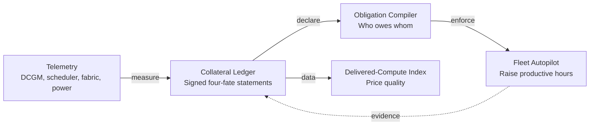

# DIMAGGI AI: what to build next

> **Date:** 2026-11-01  
> **Live version:** [DIMAGGI AI: what to build next](https://cursor.com/canvas/store-2f5a4b5a-c68b-4d09-a4a6-4db1538448be/350f2256-7b3c-4086-8298-829c67f3b3a2)  
> This file is a Markdown copy of that page. Interactive filters and charts are shown here as static tables.

**Summary:** The top recommendation is a Compute Collateral Ledger: neutral, signed, asset-level statements of usable compute for the lenders, lessors and guarantors now funding GPUs off-balance-sheet. Your repos already contain most of the measurement and audit pieces it needs.

## Contents

- [The bet](#the-bet)
- [What you have built](#what-you-have-built)
- [Where this week's deals will struggle](#where-this-weeks-deals-will-struggle)
- [Opportunity map](#opportunity-map)
  - [1. Compute Collateral Ledger](#1-compute-collateral-ledger)
  - [2. Obligation Compiler](#2-obligation-compiler)
  - [3. Governed Fleet Autopilot](#3-governed-fleet-autopilot)
  - [4. Delivered-Compute Index and offtake desk](#4-delivered-compute-index-and-offtake-desk)
  - [5. Second-life and redeployment engine](#5-second-life-and-redeployment-engine)
  - [6. Construction and energization risk monitor](#6-construction-and-energization-risk-monitor)
- [Real cluster telemetry to test against](#real-cluster-telemetry-to-test-against)
  - [What this data lets DIMAGGI build](#what-this-data-lets-dimaggi-build)
- [Synthetic 500MW fleet and chaos testing](#synthetic-500mw-fleet-and-chaos-testing)
- [How they compound](#how-they-compound)
- [Best value proposition](#best-value-proposition)
- [Risks](#risks)
- [Sources](#sources)

## The bet

> **Build the trusted measure of usable compute.** Every deal this week finances GPUs as collateral, and none of the parties can independently see what that collateral delivers. Measure it, sign it, and become the data layer that lenders, guarantors and eventually exchanges have to buy.

The partnerships can raise capital and buy chips. What they cannot easily build is a neutral, verifiable record of what the chips do, who is responsible when they do not, and what they will be worth at the end of the lease. Your portfolio has been building the measurement for that record for months.

## What you have built

| Layer | Repos | Maturity |
|---|---|---|
| Measure usable compute | network-vs-more-gpus, scheduler-vs-more-gpus, reliability-economics | Simulators with validation registries; nothing measured on operated hardware |
| Physical constraints | compute-power-placement, cooling-pue-ladder, airan-neocloud-resiliency, edge-continuum-placement | Reproducible decision models |
| Allocation and fabric | slice-packer-torus, span-contract, optical-circuit-intent | Contracts and CLIs; TAPI plans rendered, never sent |
| Governed operations | governed-autonomy, ai-cluster-chaos-fidelity | Architecture, promotion gate and CI linter; no live actuator |
| Enforce and audit | tool-guard-core, health-tool-guard | Closest to a product: v0.8.1, container image, 202 commits, Apache-2.0 |
| Declare and track | ontology-debt | Packaged on PyPI as `ontology-debt` |
| Agent tooling | d4research | Multi-agent research workspace on a T3 Code fork |

The throughline is your own phrase, turning GPU capital into usable compute, and your loop of declare, measure, enforce. The gap is also clear: the research is rigorous but simulated, and only tool-guard-core is shaped like a product. The next build should turn the models into something a counterparty signs.

## Where this week's deals will struggle

| Deal | Structure | What it cannot easily deliver |
|---|---|---|
| Broadcom and Anthropic, $63bn | SPV buys XPUs and leases them; Broadcom residual support; two lien layers | Evidence of collateral condition and use for five parties; resale market for custom silicon |
| SpaceX and Apollo, $40bn | Finance lease of Vera Rubin GPUs, about five years | Utilization proof for a lessee outside AI; second-life plan at lease end |
| Amazon, up to $80bn | Five-year floating-rate loans secured on servers | Asset-level tracking across a hyperscale fleet |
| Brookfield and Naver, about $8bn | SPV underwritten on long-term offtake | Pricing offtake quality in delivered, not rented, hours |
| Nvidia and Nscale (talks) | Chip vendor guaranteeing construction debt | Power, cooling and schedule risk a vendor has never priced |
| IREN, $363m; NexGen, $106m | GPU-backed refinancing; bankruptcy-remote SPV on take-or-pay | Covenant monitoring and SRE depth at neocloud scale |
| TPG and Ark, about $5bn (talks) | PE buying European colocation | Diligence on whether halls can host AI density |

## Opportunity map

Matrix: x axis = Slow wedge → Fast wedge (0 to 1); y axis = Lower value → Higher value (0 to 1). Quadrants: Build later (slow, higher value), Start now (fast, higher value), Fold in (slow, lower value), Quick wins (fast, lower value).

| Point | Wedge (x) | Value (y) | Quadrant |
|---|---|---|---|
| 1 Collateral Ledger | 0.8 | 0.9 | Start now |
| 2 Obligation Compiler | 0.6 | 0.82 | Start now |
| 3 Fleet Autopilot | 0.3 | 0.74 | Build later |
| 4 Delivered-Compute Index | 0.12 | 0.95 | Build later |
| 5 Redeployment | 0.42 | 0.4 | Fold in |
| 6 Energization Monitor | 0.82 | 0.32 | Quick wins |

| Rank | Opportunity | Main buyer | Likely acquirer |
|---|---|---|---|
| 1 | Compute Collateral Ledger | Lenders, lessors, guarantors | S&P, Moody's, MSCI, ICE |
| 2 | Obligation Compiler | Neocloud finance, SPV admins | Oracle, ServiceNow, Palantir |
| 3 | Governed Fleet Autopilot | Neoclouds | Nvidia, Cisco, HPE, Arista |
| 4 | Delivered-Compute Index | Offtakers, exchanges | ICE, CME, Nasdaq, LSEG |
| 5 | Redeployment engine | Lessors, RV insurers | Dell or HPE Financial Services |
| 6 | Energization monitor | Guarantors, construction lenders | Schneider, CBRE, Wood Mackenzie |

Placement is my judgement, not a measurement. Value means size of the problem and strategic pull for an acquirer; wedge means how soon a paid pilot is realistic.

### 1. Compute Collateral Ledger

The independent engineer for GPU collateral: signed, asset-level statements of usable compute for lenders, lessors and guarantors.

| Field | Detail |
|---|---|
| Problem | In an SPV the lender owns hardware it cannot see. Banks underwrite GPUs over 3 to 4 years because there is not enough history on residual value (Reuters, Oct 2026), and residual-value support only pays on a defined resale, so the guarantor needs evidence of condition and use. Today that evidence is the operator's own uptime report. |
| Deals that create it | Broadcom/Anthropic SPV (Broadcom backs residual value up to the first lien; four banks plus Blackstone need to watch it), Apollo/SpaceX lease, Brookfield/Naver SPV, NexGen via a bankruptcy-remote SPV, IREN refinancing. |
| What to build | A read-only attestation agent that sits beside DCGM, Slurm or Kubernetes, turns raw telemetry into your four-fate accounting (productive, blocked, discarded, unavailable), and signs a monthly per-pool statement on a hash-chained audit log. On top: a residual-value engine that reprices each pool under thousands of price-decline, failure and re-lease scenarios, plus agents that read every public deal document and keep a structure map per facility. |
| Why a lean team wins | Banks have no infra engineers, chip vendors and operators are not neutral, and appraisers value boxes, not delivered work. Unlimited tokens make continuous reading of filings, exhibits and telemetry cheap enough to cover small loans the big firms skip. |
| Who pays | Private-credit lenders and lessors (Apollo-, Blackstone-, Brookfield-type), on-chain GPU lenders, residual-value insurers, guarantors such as Nvidia or Broadcom, and rating agencies that need a data feed. |
| Who would acquire | S&P Global, Moody's, MSCI, KBRA, Bloomberg, ICE. Second tier: a large lessor or insurer that wants the capability in-house. |
| Builds on | network-vs-more-gpus (four-fate accounting, SEA), reliability-economics (failure regimes priced in dollars), tool-guard-core (SHA-256 hash-chained audit, offline verify), ontology-debt (declare, measure, track debt). |

#### First 90 days

1. **Weeks 1-3: publish the Compute Collateral Tape**: An open schema for what a lender should receive monthly per pool: four-fate hours, failure events, fabric and power state, contract coverage. Seed it with an agent-built structure map of this week's eight deals.
2. **Weeks 4-8: ship the attestation agent**: Ingest DCGM and scheduler exports, emit the four-fate statement, sign it with the tool-guard audit chain, and verify it offline. Run it on a public trace first so the demo is reproducible.
3. **Weeks 6-10: residual-value stress pack**: Peak stressed LTV, debt tenor against offtake tenor, and re-lease readiness, for one real structure built from public documents.
4. **Weeks 9-13: one paid pilot**: A lender or lessor in the $100m-$400m deal class (the NexGen and IREN size), with the monthly statement as a reporting covenant.

### 2. Obligation Compiler

Turns leases, offtakes, SLAs and covenants into machine-checked obligations, then settles each month: who owes whom for lost capacity.

| Field | Detail |
|---|---|
| Problem | Every big structure now has four to six parties: chip vendor, SPV, first and second lien, lessor, operator, offtaker, sometimes a guarantor. When a hall loses a week to a cooling fault, the lease, the SLA, the RV support and the debt covenant all read it differently. TCO accountability fails in that gap, not in the hardware. |
| Deals that create it | Broadcom/Anthropic (vendor, banks, Blackstone, lessee), Nvidia-backed Nscale campus for Anthropic (guarantor, builder, tenant), Naver (offtake-underwritten loan), NexGen (take-or-pay). |
| What to build | Agents read credit agreements, master leases and SLAs and compile each clause into a typed, testable rule, the way span-contract compiles admission. A monthly reconciler matches rules to telemetry, assigns every lost GPU-hour to a fate and a responsible party, and outputs credits, covenant headroom and an exceptions list with the clause cited. |
| Why a lean team wins | Legal-tech reads contracts but cannot read a cluster; infra tools read clusters but not contracts. You already think in contracts with explicit not-checked gaps. Long agreements are exactly where unlimited tokens win. |
| Who pays | Neocloud CFOs and treasury, SPV administrators, lessees with big committed spend (frontier labs), and lenders' portfolio teams. |
| Who would acquire | Oracle, ServiceNow, Palantir, SAP, or a neocloud platform such as CoreWeave that wants a finance layer. |
| Builds on | span-contract (typed envelope, six decisions, refuse rather than guess), ontology-debt (commitments as YAML, a debt ledger), scheduler-vs-more-gpus (capacity ledger), tool-guard-core (policy decisions with cited rules). |

#### First 90 days

1. **Weeks 1-4: an obligation schema**: Extract SLA, availability, credit and covenant clauses from public SEC exhibits of listed neoclouds into YAML rules.
2. **Weeks 5-9: the reconciler**: Run the rules against simulated fleets from your scheduler and reliability models; show one month's settlement with every number traced to a clause.
3. **Weeks 10-13: a design partner**: One neocloud finance team uses it on a live customer contract in shadow mode.

### 3. Governed Fleet Autopilot

Autonomous cluster and network operations that a lender will accept: planner, separate referee, autonomy earned by chaos evidence.

| Field | Detail |
|---|---|
| Problem | Standalone neoclouds borrow at double-digit yields, so every point of lost productive capacity goes straight to debt service. They cannot staff hyperscaler-grade SRE teams, and a lender will not accept an LLM with root on its collateral. |
| Deals that create it | IREN and NexGen (contracted GPUs financed against cash flow), Nscale's campus, any operator inside an Apollo- or Blackstone-funded structure. |
| What to build | A five-plane control loop from governed-autonomy: planner agents propose drains, cordons, checkpoint cadence and spare-pool sizing; a separate referee approves against an allow-list; tool-guard-core enforces and logs; autonomy levels rise only on certified chaos experiments. The pitch to the lender: every autonomous action sits in the same audit chain as the collateral statement. |
| Why a lean team wins | The incumbents sell tooling to one party. A loop that improves goodput and produces lender-grade evidence is a different product, and your modeled gap between naive and well-provisioned recovery is about $21M a month on a 16,384-GPU cluster. |
| Who pays | Neoclouds and sovereign clouds first, then colocation operators that host GPU tenants. |
| Who would acquire | Nvidia (it bought Run:ai for the scheduling layer), Cisco, HPE (now with Juniper), Arista, Dell, or CoreWeave. |
| Builds on | governed-autonomy (promotion gate, referee), ai-cluster-chaos-fidelity (linter, 25-spec catalog), reliability-economics, slice-packer-torus, optical-circuit-intent, tool-guard-core. |

#### First 90 days

1. **Weeks 1-6: an advisory, shadow-mode autopilot**: L0 and L1 only: it proposes and the operator approves. Read-only integrations.
2. **Weeks 4-10: a chaos certification service**: Lint and run an operator's existing chaos experiments against the fidelity standard; deliver a goodput-in-dollars report.
3. **Weeks 10-13: first measured result**: Turn one simulated finding into a measured one on a partner's cluster. This also closes your biggest credibility gap.

### 4. Delivered-Compute Index and offtake desk

Price the hour that actually trains or serves, not the hour that is rented, and use it to match supply to demand in financeable contracts.

| Field | Detail |
|---|---|
| Problem | CME with Silicon Data and ICE with Ornn have filed GPU rental futures, both pending CFTC review as of October. They price nominal rented hours. Your own model shows a 26-point gap between availability (ETTR 0.889) and useful capacity (0.627) at 16,384 accelerators, so two rented hours can be worth very different amounts. Offtake-underwritten loans need a way to price that quality. |
| Deals that create it | Naver (loan underwritten on long-term offtake), NexGen (take-or-pay), the SpaceX lease (a lessee from outside AI), and the coming futures. |
| What to build | A quality-adjusted index fed by ledger statements from the opportunity above, and an offtake agent that matches buyer workloads to supply pools in workload-native units, then drafts take-or-pay terms with delivered-compute SLAs. |
| Why a lean team wins | This is the network-effect end state, but it only works on data no one else has. Build it last, on top of the ledger and the compiler. |
| Who pays | Offtakers hedging cost, operators that want financeable contracts, exchanges and index providers licensing the adjustment. |
| Who would acquire | ICE, CME, Nasdaq, LSEG, Bloomberg, or the index providers themselves (Ornn, Silicon Data). |
| Builds on | scheduler-vs-more-gpus (workload-native capacity units), network-vs-more-gpus (SEA), edge-continuum-placement and compute-power-placement (site eligibility). |

#### First 90 days

1. **Weeks 1-13: research only**: A monthly public note on nominal against delivered compute, using your models and any pilot data. Partner with an index provider instead of competing until the data exists.

### 5. Second-life and redeployment engine

Answer the lessor's worst question before it happens: who can use this fleet when the first contract ends, and at what productive rate?

| Field | Detail |
|---|---|
| Problem | Residual value is set by re-deployability, not by the chip alone. Custom silicon has a thinner second-hand market than Nvidia parts, which is one reason a vendor writes residual support at all. Tenors are set to sit inside the offtake because any balance that outlives it depends on a resale market that may not exist. |
| Deals that create it | Broadcom/Anthropic XPUs, Apollo's Vera Rubin fleet after a five-year lease, IREN and NexGen re-contracting older GPUs. |
| What to build | A re-placement engine across heterogeneous silicon: given a pool's chip generation, fabric, torus or fat-tree shape, rack density and power, it lists the workloads and tenant types it can serve, the productive rate for each, and the work (re-cabling, re-cooling, re-slicing) needed to get there. |
| Why a lean team wins | Agents can benchmark and simulate every chip and workload pair at a scale no remarketer will attempt, and lessors have no tool for this today. |
| Who pays | Lessors, RV insurers, guarantors writing residual support, and IT asset remarketers. |
| Who would acquire | Dell Financial Services, HPE Financial Services, a large aircraft-style lessor moving into compute, or an RV insurer. |
| Builds on | slice-packer-torus, edge-continuum-placement, cooling-pue-ladder, network-vs-more-gpus (latency-regime atlas). |

#### First 90 days

1. **Weeks 1-13: a re-lease readiness score**: Fold into the ledger's stress pack as a feature first. Spin out only if lessors pay for it on its own.

### 6. Construction and energization risk monitor

For whoever guarantees construction debt: will this campus energize on time, at the density and PUE the deal assumed?

| Field | Detail |
|---|---|
| Problem | If Nvidia guarantees Nscale's construction debt, a chip vendor is holding power, cooling and schedule risk it has never priced. The same is true for any lender before commercial operation. |
| Deals that create it | Nvidia and Nscale (talks), Brookfield/Naver, TPG and Ark Data Centres (in talks). |
| What to build | Agents that track interconnection queues, permits, procurement and public filings per campus, combined with your power, cooling and resiliency models, to give a monthly probability of on-time energization at the contracted MW. |
| Why a lean team wins | It runs on public data, so it can start now with no customer data, and the models already exist. |
| Who pays | Guarantors, construction lenders, infrastructure funds and offtakers waiting on a campus. |
| Who would acquire | Schneider Electric, CBRE, JLL, Wood Mackenzie, or a large infrastructure fund. |
| Builds on | compute-power-placement, cooling-pue-ladder, airan-neocloud-resiliency. |

#### First 90 days

1. **Weeks 1-13: a public watchlist**: Ten announced campuses, scored monthly. It works as marketing for the ledger even if it never becomes a product.

## Real cluster telemetry to test against

I found 58 openly published sources (as of Nov 1, 2026) across NVIDIA, Google TPU and AMD generations, plus price feeds. The full list, with download commands, licences and what each one tests, is in `/workspace/dimaggi/telemetry-sources.json`. The best 24 are below.

#### NVIDIA (11)

| Source | Generation | What | Scale | Licence | Ledger test |
|---|---|---|---|---|---|
| ByteDance llm-training-alert-trace | Anonymised GPU generation per job | 344,273 production alert events linked to node health | 98 LLM training jobs | See HF card | Failure rates, fault attribution |
| StepFun InfiniteHBD-Trace | 2024 GPU servers | Node fault start/end with component class | 400 servers, 348 days | Apache-2.0 | MTBF, MTTR, availability |
| Delta (NCSA) XID artifacts | A100 vs H100 | XID error stats and propagation by category | 1,056 GPUs, 11.7M GPU-hours | Zenodo record | Failure rate by generation, memory degradation |
| Acme trace (Seren, Kalos) | A100 | 880,740 jobs, DCGM utilisation, IPMI power, LLM failures | Two clusters, 6 months 2023 | CC-BY-4.0 | Usable hours, utilisation, power |
| Alibaba cluster-trace-gpu-v2026 | Mixed, anonymised | Hourly pod utilisation, server inventory, network | Peak 155,410 GPUs, 6 months | Alibaba trace terms | Utilisation, stranded capacity |
| Alibaba v2026 MaaS and spot-GPU | 30 GPU types; 6 card types | Production LLM inference; spot vs high-priority jobs | 100,000+ GPUs; 4,278 nodes | Alibaba trace terms | Utilisation by GPU type, preemption |
| Meta RSC and Llama 3 reliability stats | A100; H100 | MTTF vs job size, ETTR; 466 interruptions in 54 days | 150M+ GPU-hours; 16,384 H100 | arXiv papers | MTBF at scale, ETTR calibration |
| Reveal telemetry | HPC GPU nodes | 150+ metric types at 100 ms, repeated ML runs | Controlled runs, 4.5 GB | CC-BY-4.0 | Attestation agent parsing, anomalies |
| LLM-PowerTrace | L40S, A100, H100, H200 | 100 ms per-GPU power for 2,193 runs | Single 4-GPU nodes | See site (full release pending) | Power per token by generation |
| MIT Supercloud | V100 | 100 ms GPU utilisation, power, temperature per job | About 2 TB | CC BY-NC-ND (test only) | Power, utilisation |
| OLCF Summit power and DBE sets | V100 | 10 s component power and thermal; double-bit error snapshots | 27,756 V100 | DOE open data | Aging and degradation proxy |

#### Google TPU (5)

| Source | Generation | What | Scale | Licence | Ledger test |
|---|---|---|---|---|---|
| TPU v4 resiliency (NSDI '24) | TPU v3 vs v4 | Daily failure rates for machines, ICI cables, OCS; availability | 4,096-chip pods | USENIX open access | Availability, TPU failure rates |
| Ironwood superpod reliability model | TPU7x Ironwood | Topological availability of a 144-cube superpod | 8,320-chip block | Google blog | Newest-generation availability |
| Gemini 1 report; TPU v4 ISCA paper | TPU v4, v5e | Goodput 85% to 97%; perf/W vs prior generation | Multi-pod training | arXiv | Goodput, perf/W by generation |
| Cloud TPU pricing page | v2, v3, v4, v5e, v5p, Trillium, Ironwood | Per-chip-hour list, commitment and spot prices by region | All TPU generations | Google terms | Price by generation over time |
| Google PowerData2019 and ClusterData2019 | Borg cells, no TPU split | 57 power domains; Borg jobs at 5 min | 8 cells, May 2019 | CC-BY | Power vs utilisation |

#### AMD (2)

| Source | Generation | What | Scale | Licence | Ledger test |
|---|---|---|---|---|---|
| OLCF Frontier job-centric telemetry | MI250X | 152,400 jobs linked to node power, temperature, network | Exascale, 2024-2025 | DOE open data | Usable hours, power, AMD baseline |
| Frontier HPL power; MI300X dataset | MI250X; MI300X | 15 s HPL power; benchmark telemetry on 8 MI300X | Full system; one node | CC-BY-4.0 | Perf/W across AMD generations |

#### Cross-vendor and prices (6)

| Source | Generation | What | Scale | Licence | Ledger test |
|---|---|---|---|---|---|
| MLPerf Training and Inference (with Power) | NVIDIA, Google TPU, AMD, Intel per round | Time-to-train, throughput, measured power, system specs | Up to thousands of chips | Apache-2.0 | Perf and perf/W by vendor and generation |
| Azure Retail Prices API | H100, H200, MI300X, A100 | On-demand, spot, low-priority, reservation prices | All regions | Public API | Price and spot discount by generation |
| AWS price list and Spot data | Trainium, Inferentia, P5/P6 | On-demand and reserved prices; 90-day spot history | All regions | AWS terms | Trainium vs GPU price |
| vast.ai offers; Silicon Data index | RTX to H200/B200 | Live $/h with host reliability; daily H100 and B200 index | Thousands of hosts; market | Site terms; free tier | Market price, host reliability |
| ATLAHS traces | GH200 (CSCS Alps) | Nsight traces of Llama and MoE training communication | Up to 256 GPUs | MIT code; see site | Blocked time from network |
| Azure LLM, BurstGPT, Mooncake traces | Production serving fleets | Request arrivals and token counts | Production services | CC-BY-4.0; Apache-2.0 | Demand shape for offtake sizing |

> [!WARNING]
> **TPUs are the thinnest part of the public record.** Google has released no TPU fleet trace. TPU evidence is published statistics (v3 vs v4 availability, daily failure rates, Gemini goodput, the Ironwood availability model) plus the only official per-generation price list. Trainium, Inferentia, Gaudi, Cerebras, Groq, MTIA and Broadcom XPUs have prices, MLPerf entries or papers at best, and no public telemetry.

### Download first

1. **Failure traces**: `git clone https://github.com/stepfun-ai/InfiniteHBD-Trace` and `load_dataset('bytedance-research/llm-training-alert-trace','events')`
2. **Jobs, DCGM and power for LLM work**: `git clone https://github.com/InternLM/AcmeTrace`, then `huggingface-cli download Qinghao/AcmeTrace --repo-type dataset`
3. **A100 vs H100 XID artifacts**: `curl -s https://zenodo.org/api/records/15287639` and fetch each file link
4. **100 ms telemetry for the parser**: `curl -L -o Reveal.zip https://zenodo.org/api/records/17470313/files/Reveal.zip/content` (4.5 GB)
5. **Hyperscale utilisation**: Alibaba v2026 OSS bucket: start with `asi_opensource_server_hourly.zip` (3 GB), not the 352 GB pod table
6. **AMD MI250X job telemetry**: Frontier job-centric dataset at osti.gov/biblio/3682474, via Globus
7. **Benchmarks by generation**: `git clone --depth 1` mlcommons `training_results_v5.1` and `inference_results_v6.0`; read `systems/*.json`
8. **Daily price snapshots**: Azure Retail Prices API, Cloud TPU pricing page, AWS price list, vast.ai offers, Lambda status incidents

### Live feeds to poll

- Azure Retail Prices API: on 2026-11-01, ND96isr_H100_v5 in eastus was $98.32/h on demand and $18.17/h spot.
- Cloud TPU pricing page: the only official price series covering TPU v2 through Ironwood; snapshot it daily.
- vast.ai public offers: live $/h plus a reliability score per host.
- Silicon Data H100 and B200 daily index (free tier keeps 30 days); Ornn OCPI on ICE.
- Provider status APIs such as status.lambda.ai for incident start and resolve times.
- EIA and ISO price feeds for the power line of TCO.

### What is not public, and how to get it

| Gap | How to get it |
|---|---|
| Per-asset telemetry from neocloud and SPV fleets | Design partner: read-only DCGM exporter feed under NDA, or a lender-required reporting covenant |
| Any TPU fleet trace | A Google Cloud customer shares its Cloud Monitoring TPU health metrics; TPU Research Cloud projects |
| Trainium, Gaudi, MTIA, XPU telemetry | A partner running Neuron Monitor or vendor tools; vendor partnerships |
| Blackwell and GB200 failure rates | Nothing public yet; ClusterMAX gives qualitative operator ratings only |
| Resale transactions for used accelerators | Ornn or Silicon Data paid data, broker quotes, eBay API with a free developer key |
| Perlmutter DCGM data | Restricted DOE data: needs a NERSC collaboration |

### What this data lets DIMAGGI build

| Build | Datasets | First test |
|---|---|---|
| Silicon-agnostic usable-compute unit for SPV underwriting (GPU, TPU, XPU) | MLPerf per generation, Epoch hardware specs, TPU v4 NSDI rates, Meta RSC and Delta failure rates | Four-fate hours for an A100 Acme cluster and a published TPU v4 pod, side by side in one unit |
| Generation-aware residual value curves | Cloud TPU v2 to Ironwood prices, Azure and AWS prices with effective dates, vast.ai, Silicon Data, Delta and Summit aging data | Price per productive hour against chip age, for V100, A100, H100, TPU v4 and v5e |
| Real failure-regime library for reliability-economics | StepFun faults, ByteDance alerts, Delta XID, Summit DBE, Llama 3 table | Replace the simulated fault process with fitted ones and rerun the phase diagram |
| Cross-architecture power and TCO covenant tester | LLM-PowerTrace, Frontier job telemetry, Summit power, MLPerf Power, Acme IPMI | Energy per useful hour and ramp limits for NVIDIA vs AMD generations |
| Delivered-compute demand benchmark | Azure LLM traces, BurstGPT, Mooncake, Alibaba MaaS and spot-GPU | How much committed capacity a real demand curve actually uses |

The first build is the strongest because no public source puts GPUs and TPUs in one productive unit. Lenders financing Broadcom XPUs next to Nvidia fleets will need exactly that.

## Synthetic 500MW fleet and chaos testing

Real traces stop at one cluster and one vendor, and none has labels. So I built a seeded generator of a 500 MW fleet, spread over six campuses and 13 accelerator generations. It produces DCGM-style telemetry plus the ground truth for every 5-minute interval: whether each device-hour was useful, degraded, discarded, blocked, idle, down or undelivered, why, and who is responsible (vendor, operator, grid or tenant). Run the ledger and the obligation logic on the telemetry, then score them against the truth.

| Campus | Silicon (accelerators) | Total | PUE | Facility MW |
|---|---|---|---|---|
| TX1 ERCOT, liquid | GB200 NVL72 40,968; B200 20,864; H200 14,624 | 76,456 | 1.15 | 150.0 |
| VA1 PJM, air + rear door | H100 31,616; H200 14,368; A100 18,048 | 64,032 | 1.30 | 100.1 |
| IA1 MISO, TPU campus | Ironwood 44,416; Trillium 55,360; v5p 38,080; v5e 29,760; v4 31,744 | 199,360 | 1.10 | 110.0 |
| FI1 Nordics, liquid | MI355X 12,160; MI300X 11,552; H100 8,000 | 31,712 | 1.12 | 60.0 |
| KR1 Korea, air | H200 13,824; H100 13,824 | 27,648 | 1.35 | 50.0 |
| OR1 WECC, air + rear door | Trainium2 18,304; A100 11,264 | 29,568 | 1.25 | 30.0 |
| Fleet | 13 generations, 1,112 pods, 531 jobs | 428,776 | 1.185 | 500.04 |

Device counts come from TDP plus host plus 5% network overhead, multiplied by PUE, at rack granularity. The hierarchy is site, hall, pod or superpod, rack, node, device, with each fabric modelled (InfiniBand, RoCE, NVLink72, ICI with optical circuit switches). One knob scales the fleet: the 1 GW run (857,456 devices) takes 12 seconds for 7 days.

### Chaos scenarios (16)

| Scenario | Blast radius | Party |
|---|---|---|
| Device failure burst, single node failure | 2% of nodes in a generation, or one node | Vendor |
| Rack PDU loss | 4 racks | Operator |
| Cooling event | One hall: PUE +0.25, 30% throttle, 1% thermal trips | Operator |
| Hall outage, site outage | One hall for 8 h; a whole campus for 10 h | Operator, grid |
| Grid curtailment | Campus capped at 70% of facility power for 4 h | Grid |
| OCS fault | TPU superpod rerouted at 92.2% throughput; 5% of jobs blocked | Vendor |
| Cable or optic burst | 25 IB/RoCE links or ICI cubes | Operator |
| Network partition | Half the pods of a campus for 2 h | Operator |
| Silent data corruption | One training job: 6 h of work discarded, plus a node repair | Vendor |
| Straggler | Two jobs slowed by 25% for 18 h | Operator |
| Bad firmware rollout | 4 waves of reboots on 10% of nodes, then 8x failures for 24 h | Vendor |
| Cascading multi-site | Hall outage, then a demand surge, a cap and a partition at other campuses | Operator, grid |
| Supply delay | Half of a generation not delivered for 18 days | Vendor |
| Demand shock | Inference demand x1.6 for 24 h | Tenant |

The default run schedules 14 of these over 30 days. In Monte Carlo mode the generator samples scenarios, start times and targets for each seed.

### Calibrated vs assumed

| Input | Source | Status |
|---|---|---|
| H100 interruption rate; planned vs unexpected mix | Llama 3 (419 unexpected in 54 days on 16,384 GPUs) | Calibrated |
| A100 node MTTF | Meta RSC | Calibrated |
| Fault class mix, repair-time distribution | StepFun InfiniteHBD trace | Derived |
| Multi-node faults, RDMA link flaps | ByteDance alert trace | Derived |
| TPU machine, ICI cable and OCS failure rates; fault-tolerant routing | TPU v4 NSDI papers | Calibrated |
| Idle power for A100, H100 and H200; host power | LLM-PowerTrace; DGX datasheets | Calibrated |
| H100 vs A100 memory-error ratio | NCSA Delta | Calibrated |
| Failure rates for Blackwell (x1.3 to x1.5), H200, AMD, Trainium2, TPU v5 to Ironwood | None public | Assumption |
| Restart and checkpoint times; all chaos magnitudes; TPU, AMD and Trainium watts | None public | Assumption |

There are 65 parameters in total: 21 calibrated, 5 derived and 39 assumptions. Each one carries its source in `docs/CALIBRATION.md`. A baseline run passes all 20 validation checks: H100 interruptions run at 4.68e-4 per GPU-day against 4.74e-4 in the source, large-job ETTR is 0.893 against 0.85 to 0.90, TPU goodput is 0.968 against 0.97, repair-time median is 0.935 days, idle power matches PowerTrace within 1%, and the fate identity is exact. ETTR and goodput are not independent checks, because restart times were tuned to hit them.

### One chaos run, by campus

#### Delivered (useful %)

| Day | Fleet | TX1 | VA1 | IA1 | FI1 | KR1 | OR1 |
|---|---|---|---|---|---|---|---|
| Oct 1 | 78.7 | 80 | 73.1 | 85.3 | 65.4 | 66.4 | 68.4 |
| Oct 2 | 79.1 | 81.6 | 74.3 | 85.1 | 65.7 | 67 | 68.1 |
| Oct 3 | 75 | 61.7 | 71.5 | 84.8 | 65.3 | 65.9 | 69.4 |
| Oct 4 | 78.9 | 78.6 | 74.2 | 85.7 | 64.8 | 67 | 70 |
| Oct 5 | 78.2 | 74.9 | 73.6 | 86 | 66.9 | 66.8 | 67.2 |
| Oct 6 | 77.9 | 75.7 | 73.9 | 84.9 | 65.2 | 67 | 67.6 |
| Oct 7 | 78.9 | 82.4 | 74.4 | 84.6 | 64.6 | 66.5 | 67.6 |
| Oct 8 | 78.8 | 80.1 | 74.5 | 84.9 | 66 | 66.7 | 68 |
| Oct 9 | 78.5 | 78.9 | 71.9 | 85.4 | 66.6 | 66.8 | 68.1 |
| Oct 10 | 78 | 79.3 | 73.8 | 84.8 | 63.3 | 60.8 | 68.9 |
| Oct 11 | 78.8 | 79.4 | 74.4 | 85.1 | 65.9 | 67.1 | 69.1 |
| Oct 12 | 78.6 | 80.6 | 72.4 | 85 | 65.8 | 65.7 | 69.7 |
| Oct 13 | 78.2 | 77.4 | 73.8 | 85.2 | 64 | 67.2 | 68.2 |
| Oct 14 | 78.9 | 82 | 71.5 | 85.4 | 66.3 | 66.4 | 68.2 |
| Oct 15 | 78 | 78.2 | 71.9 | 85 | 65.4 | 66.8 | 67.7 |
| Oct 16 | 78.2 | 78.3 | 71.7 | 85.1 | 66.3 | 66.5 | 69.5 |
| Oct 17 | 77.8 | 78 | 73.8 | 84.8 | 60.2 | 67.3 | 67.8 |
| Oct 18 | 78 | 79.2 | 73.8 | 84.2 | 65 | 66 | 66.9 |
| Oct 19 | 78.2 | 77.9 | 68.1 | 85.2 | 75 | 67.3 | 67 |
| Oct 20 | 79.2 | 78.9 | 71.7 | 85.1 | 77.4 | 67 | 69.8 |
| Oct 21 | 80.1 | 80.5 | 75.7 | 84.8 | 77.6 | 69.5 | 69.3 |
| Oct 22 | 80.9 | 78.6 | 75.3 | 86.1 | 77 | 78.9 | 69.7 |
| Oct 23 | 78.9 | 76.7 | 71.5 | 85.9 | 75.6 | 66.5 | 68.7 |
| Oct 24 | 80.2 | 73.6 | 72.5 | 88.8 | 76.7 | 74.7 | 65.4 |
| Oct 25 | 80 | 77.1 | 72.5 | 86.9 | 77.3 | 72.3 | 67.2 |
| Oct 26 | 78.3 | 77.4 | 71.8 | 83.8 | 78.1 | 67 | 69.2 |
| Oct 27 | 79.2 | 77.9 | 74.9 | 84.7 | 76.3 | 67 | 69.7 |
| Oct 28 | 77.7 | 80.8 | 72.5 | 85 | 78.9 | 67.2 | 40.4 |
| Oct 29 | 79.7 | 80.3 | 73.5 | 85.3 | 78.7 | 65.7 | 68.4 |
| Oct 30 | 79.5 | 80.6 | 73.3 | 85 | 77.4 | 67.1 | 67.1 |

#### Usable (not down or undelivered %)

| Day | Fleet | TX1 | VA1 | IA1 | FI1 | KR1 | OR1 |
|---|---|---|---|---|---|---|---|
| Oct 1 | 95.9 | 96.4 | 96.1 | 99.2 | 77.4 | 96.3 | 91 |
| Oct 2 | 95.9 | 96.5 | 96 | 99.2 | 77.2 | 96.5 | 91 |
| Oct 3 | 95.8 | 96.1 | 96 | 99.2 | 77.3 | 96.4 | 91 |
| Oct 4 | 95.9 | 96.4 | 95.9 | 99.3 | 77.4 | 96.4 | 91.1 |
| Oct 5 | 95.9 | 96.4 | 96 | 99.4 | 77.3 | 96.2 | 91.3 |
| Oct 6 | 95.9 | 96.4 | 96 | 99.3 | 77.3 | 96.2 | 91.1 |
| Oct 7 | 95.8 | 96.2 | 96.2 | 99 | 77.3 | 96.3 | 91.3 |
| Oct 8 | 95.8 | 96.3 | 96.1 | 99 | 77.3 | 96.2 | 91.4 |
| Oct 9 | 95.8 | 96.4 | 95.9 | 99.1 | 77.3 | 96.3 | 91.5 |
| Oct 10 | 95.9 | 96.3 | 96 | 99.3 | 77.2 | 96.4 | 91.3 |
| Oct 11 | 95.9 | 96.4 | 96 | 99.3 | 77.2 | 96.6 | 91.6 |
| Oct 12 | 95.9 | 96.4 | 95.9 | 99.3 | 77.2 | 96.3 | 91.8 |
| Oct 13 | 96 | 96.4 | 95.9 | 99.4 | 77.2 | 96.4 | 91.6 |
| Oct 14 | 96 | 96.4 | 96 | 99.4 | 77.2 | 96.6 | 91.2 |
| Oct 15 | 96 | 96.4 | 95.9 | 99.4 | 77.4 | 96.4 | 91.7 |
| Oct 16 | 96 | 96.3 | 95.9 | 99.4 | 77.6 | 96.4 | 92.2 |
| Oct 17 | 96 | 96.4 | 96.2 | 99.2 | 77.6 | 96.5 | 91.9 |
| Oct 18 | 96 | 96.3 | 96.2 | 99.3 | 77.6 | 96.6 | 91.9 |
| Oct 19 | 96.5 | 96.3 | 91.2 | 99.3 | 95.4 | 96.6 | 91.5 |
| Oct 20 | 97 | 96.4 | 94.4 | 99.3 | 95.5 | 96.4 | 91.4 |
| Oct 21 | 97.3 | 96.5 | 96.2 | 99.3 | 95.4 | 96.4 | 91.6 |
| Oct 22 | 97.4 | 96.5 | 96.4 | 99.3 | 95.3 | 96.4 | 91.8 |
| Oct 23 | 97.4 | 96.5 | 96.6 | 99.4 | 95.4 | 96.4 | 91.8 |
| Oct 24 | 96.4 | 90.9 | 96.6 | 99.3 | 95.6 | 96.3 | 91.6 |
| Oct 25 | 97.3 | 96.4 | 96.5 | 99.1 | 95.8 | 96.4 | 91.4 |
| Oct 26 | 97.3 | 96.4 | 96.4 | 99.1 | 95.9 | 96.4 | 91.5 |
| Oct 27 | 97.3 | 96.4 | 96.4 | 99 | 96.2 | 96.4 | 91.8 |
| Oct 28 | 94.8 | 96.5 | 96.3 | 99.2 | 96.5 | 96.4 | 53.8 |
| Oct 29 | 97.5 | 96.6 | 96.1 | 99.4 | 96.3 | 96.2 | 91.7 |
| Oct 30 | 97.5 | 96.6 | 96.1 | 99.5 | 96 | 96.2 | 91.5 |

> [!NOTE]
> **Usable is not delivered.** Across the fleet, 96.3% of device-hours were usable but only 78.7% were useful. The gap breaks down by responsible party as tenant 13.4% (mostly idle inference capacity), vendor 4.4%, operator 2.1%, unattributed 1.3% and grid 0.1%. Against contract targets the run is 10.4M device-hours short, and 58% of that shortfall traces to vendors. The chaos events show up as dips: TX1 firmware rollout (Oct 3), KR1 cooling event (Oct 10), VA1 hall outage (Oct 19), OR1 site outage (Oct 28). FI1 jumps on Oct 19 when its late MI355X racks arrive. Across 5 Monte Carlo seeds, the useful share is 79.0% ± 0.3% and the shortfall is 9.3M ± 0.9M device-hours.

The code is in `/workspace/dimaggi/synthetic-fleet` (`python -m synthfleet run | montecarlo | validate | bom`), packaged as `synthetic-fleet.tar.gz`. It would sit in `reliability-economics` next to the chaos-fidelity work. Nothing has been pushed.

## How they compound

It is your declare, measure, enforce loop, applied to capital instead of models. Each product adds data to the next, and the audit chain is shared.

## Best value proposition

> **DIMAGGI AI is the neutral measure of usable compute: the number everyone finances and no one audits.** Sell it first to whoever carries the risk without seeing the asset, which is lenders, lessors and guarantors. Make the monthly signed statement a reporting covenant, so operators adopt it because their financing requires it.

- Neutrality is the moat: not a chip vendor, not an operator, not a lender.
- The unit is the productive GPU-hour, which neither the rental indexes nor accounting depreciation measures.
- Unlimited tokens go into reading every deal document, filing and telemetry stream continuously, which no human team can afford.
- Exit logic: rating agencies, data vendors and exchanges keep neutrality intact, so they pay most for it.
- Positioning line: from GPU capital to usable compute, measured, signed and settled.

## Risks

| Risk | Mitigation |
|---|---|
| Operators will not share telemetry | Sell to the lender and make the statement a covenant; start with read-only exports |
| Everything so far is simulated | Make the first pilot a measured result; publish it the way you publish the models |
| Incumbents move first: Silicon Data, Ornn, appraisers, Nvidia's own tooling | Stay at the asset and contract level they do not cover; partner on the index |
| Ratings and benchmark regulation | Call it an attestation or monitoring report, not a rating or index, until there is counsel and scale |
| Liability if a lender relies on a wrong statement | Show what is not checked on every statement, as span-contract does; cap scope in the engagement terms |
| The financing cycle cools | Distress raises demand for monitoring and redeployment work, so the ledger also sells into a downturn |
| Focus: 17 repos across many layers | Pick one buyer and one statement; fold the rest in as features |

## Sources

- [Broadcom and Anthropic compute SPV with BofA, Blackstone, Citi, Morgan Stanley](https://investors.broadcom.com/news-releases/news-release-details/bank-america-blackstone-citi-and-morgan-stanley-announce) — investors.broadcom.com, Oct 26, 2026
- [SpaceX locks in $40B GPU financing deal with Apollo](https://techcrunch.com/2026/10/26/spacex-locks-in-40b-gpu-financing-deal-with-apollo/) — techcrunch.com, Oct 26, 2026
- [Amazon sets up $80 billion supplier financing for AI hardware](https://www.investing.com/news/stock-market-news/amazon-sets-up-80-billion-supplier-financing-for-ai-hardware-4988386) — investing.com, Oct 30, 2026
- [Brookfield and Naver Cloud GPU loan](https://www.koreaherald.com/article/10921731) — koreaherald.com, Nov 1, 2026
- [Nvidia weighs playing the cosigner for Nscale's AI data center](https://techcrunch.com/2026/10/30/nvidia-weighs-playing-the-cosigner-for-nscales-ai-data-center-in-west-virginia/) — techcrunch.com, Oct 30, 2026
- [IREN and Wingspire complete $363 million financing](https://www.nasdaq.com/press-release/iren-and-wingspire-equipment-finance-complete-363-million-financing-high-density-ai) — nasdaq.com, Oct 28, 2026
- [USD.AI $106M NexGen Cloud GPU financing](https://usd.ai/blog/usdai-106m-nexgen-cloud-finland-gpu-financing) — usd.ai, Oct 29, 2026
- [TPG in talks to acquire Ark Data Centres](https://irei.com/news/tpg-in-talks-to-acquire-ark-data-centres-for-approximately-5b/) — irei.com, Oct 28, 2026
- [Nvidia's bet that its chips can finance the AI boom gets a Wall Street reality check](https://www.reuters.com/legal/transactional/nvidias-bet-that-its-chips-can-finance-ai-boom-gets-wall-street-reality-check-2026-10-01/) — reuters.com, Oct 1, 2026
- [SOMA GPU Collateral Note](https://soma-assurance.com/documents/SOMA-GPU-Collateral-Note-Oct2026.pdf) — soma-assurance.com, Oct 2026
- [What Is an Old GPU Worth?](https://dilikogluresearch.com/reports/old-gpu-worth-2026-10-29/pdf) — dilikogluresearch.com, Oct 29, 2026
- [CME Group and Silicon Data to launch compute futures](https://investor.cmegroup.com/news-releases/news-release-details/cme-group-and-silicon-data-launch-compute-futures-october-5) — cmegroup.com
- [ICE and Ornn to launch GPU compute futures contracts](https://ir.theice.com/press/news-details/2026/ICE-and-Ornn-to-Launch-GPU-Compute-Futures-Contracts/default.aspx) — theice.com, May 19, 2026
- [DIMAGGI AI repositories](https://github.com/orgs/dimaggi-ai/repositories) — github.com
- [ByteDance llm-training-alert-trace](https://huggingface.co/datasets/bytedance-research/llm-training-alert-trace) — huggingface.co
- [StepFun InfiniteHBD-Trace](https://github.com/stepfun-ai/InfiniteHBD-Trace) — github.com
- [Story of Two GPUs: A100 and H100 resilience on Delta](https://arxiv.org/abs/2503.11901) — arxiv.org
- [Acme trace (Shanghai AI Lab)](https://github.com/InternLM/AcmeTrace) — github.com
- [Alibaba cluster traces incl. 2026 releases](https://github.com/alibaba/clusterdata) — github.com
- [Revisiting reliability in large-scale ML research clusters (Meta)](https://arxiv.org/abs/2410.21680) — arxiv.org
- [The Llama 3 herd of models](https://arxiv.org/abs/2407.21783) — arxiv.org
- [Resiliency at scale: Google's TPUv4 supercomputer](https://www.usenix.org/conference/nsdi24/presentation/zu) — usenix.org
- [Cluster reliability for trillion-parameter models on TPUs](https://cloud.google.com/blog/products/compute/cluster-reliability-for-trillion-parameter-models-on-tpus) — cloud.google.com, May 11, 2026
- [Gemini: a family of highly capable multimodal models](https://arxiv.org/abs/2312.11805) — arxiv.org
- [Cloud TPU pricing](https://cloud.google.com/tpu/pricing) — cloud.google.com
- [Frontier job-centric telemetry dataset](https://www.osti.gov/biblio/3682474) — osti.gov
- [Reveal hardware telemetry dataset](https://doi.org/10.5281/zenodo.17470313) — zenodo.org
- [LLM-PowerTrace](https://arxiv.org/abs/2610.38315) — arxiv.org
- [MIT Supercloud dataset](https://registry.opendata.aws/dcc/) — registry.opendata.aws
- [MLPerf Inference v6.0 results](https://github.com/mlcommons/inference_results_v6.0) — github.com
- [Azure Retail Prices API](https://prices.azure.com/api/retail/prices) — prices.azure.com
- [ATLAHS trace collection](https://spcl.inf.ethz.ch/Research/Scalable_Networking/ATLAHS/) — spcl.inf.ethz.ch
- [SemiAnalysis ClusterMAX 3.0](https://newsletter.semianalysis.com/p/clustermax-30-the-industry-standard) — semianalysis.com
